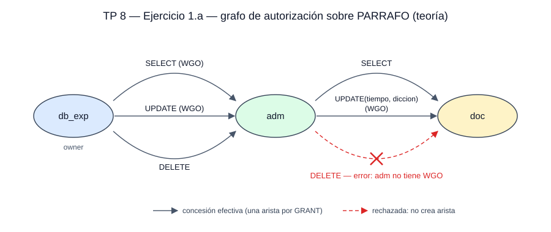

# TP 8 — Resolución y observaciones

El registro ejecutable está en [seguridad.sql](seguridad.sql). Este documento
explica el razonamiento y contrasta la teoría con lo que hace MySQL. Fuente:
[P08, pp. 1–3].

## Entorno

MySQL 9.7.2 en el contenedor `bd2-mysql`.

| Base | Ejercicio | Usuarios |
|---|---|---|
| `tp8_exp` | 1 | `db_exp`, `adm`, `doc` |
| `tp8_vol` | 2 | `u0` (administrador), `u1`–`u4`; rol `ins_vol` |

La preparación corre como `root`; cada sección posterior de `seguridad.sql`
indica con qué usuario conectarse. Dos detalles de operación:

- **MySQL no tiene owner.** Crear una tabla no da ningún privilegio sobre ella.
  El rol de owner se simula con `GRANT ALL ON base.* … WITH GRANT OPTION`.
- **`SHOW GRANTS FOR otro_usuario` exige leer el esquema `mysql`.** `db_exp` no
  puede ver qué conserva `doc` (`ERROR 1142`); hay que consultarlo como `root`.

## Marco conceptual

Autenticar es establecer quién es el usuario; autorizar, qué puede hacer.
[T11, p. 5] Un privilegio asocia un usuario, una operación y un objeto. `GRANT`
lo concede, `WITH GRANT OPTION` (WGO) habilita a quien lo recibe a concederlo a
terceros, y `REVOKE` lo retira. [T11, pp. 10, 12]

*Complemento del agente (no consta en el material cargado salvo el ejemplo
P08A):* la teoría estándar agrega cuatro piezas que el TP da por sabidas.

1. **Owner.** El creador de un objeto tiene todos los privilegios sobre él, con
   WGO. Es la raíz de toda concesión.
2. **Reglas de concesión.** Solo se concede lo que se tiene con WGO; se puede
   conceder un subconjunto (algunas columnas de un `UPDATE` de tabla), nunca
   más. La WGO es **por privilegio**.
3. **Grafo de autorización.** Nodos = usuarios; cada `GRANT` exitoso es una
   arista *concedente → receptor* rotulada con el privilegio. **Un usuario
   conserva un privilegio mientras exista un camino desde el owner hasta él.**
4. **`REVOKE … CASCADE`** borra la arista y todo lo que quede sin camino.
   `RESTRICT` rechaza el `REVOKE` si dejaría a alguien sin camino.

P08A ilustra la cascada: User 0 revoca a User 1 el `INSERT` sobre T1 y User 2
pierde el que había recibido de User 1, pero conserva el `UPDATE` y el `DELETE`
sobre V2 que recibió directamente de User 0. [P08A]

## Ejercicio 1 — `PARRAFO`, owner `db_exp`

### 1.a — grafo y errores

| # | Sentencia | Teoría | Por qué |
|---|---|---|---|
| 1–3 | `db_exp` → `adm`: `SELECT` WGO, `UPDATE` WGO, `DELETE` | pasan | `db_exp` es owner |
| 4 | `adm` → `doc`: `SELECT` | pasa | `adm` tiene `SELECT` con WGO |
| 5 | `adm` → `doc`: `UPDATE(tiempo, diccion)` WGO | pasa | subconjunto de un `UPDATE` de tabla que `adm` tiene con WGO |
| 6 | `adm` → `doc`: `DELETE` | **error** | `adm` recibió `DELETE` **sin** WGO |



La quinta le da a `doc` `UPDATE` sobre `tiempo` y `diccion`, no sobre la clave.
Hay una arista por `GRANT`, sin agrupar: es lo que permite revocar privilegio
por privilegio en el 1.b.

### 1.a en MySQL: las seis devuelven `Query OK`

Estado resultante en `mysql.tables_priv`:

| User | Grantor | `Table_priv` | `Column_priv` |
|---|---|---|---|
| `adm` | `db_exp` | `Select,Update,Delete,Grant` | |
| `doc` | `adm` | `Select,Delete,Grant` | `Update` |

Dos diferencias con la teoría, ambas visibles en esa tabla:

- **La `GRANT OPTION` es un único flag por nivel, no uno por privilegio.**
  `Grant` aparece una vez, junto a los demás permisos de la tabla. Quien la
  tiene puede conceder cualquier privilegio que posea en ese nivel, incluidos
  los que reciba después. Por eso la sexta sentencia funciona: `adm` recibió la
  `GRANT OPTION` con el `SELECT` y le alcanza para delegar el `DELETE`.
- **La WGO de un privilegio de columna sube a la tabla.** MySQL no admite
  `GRANT OPTION` sobre columnas. `doc` la recibió con `UPDATE(tiempo, diccion)`
  y quedó habilitado para delegar también `SELECT` y `DELETE`: verificado, `doc`
  pudo ejecutar `GRANT SELECT, DELETE ON parrafo TO otro_usuario`.

*Complemento del agente (no consta en el material cargado): comportamiento
documentado en el manual de `GRANT` de MySQL y verificado en 9.7.2.*

**La diferencia de fondo:** hay **una fila por usuario y objeto**, con un único
`Grantor` informativo (el último que concedió). MySQL guarda conjuntos de
privilegios, no un grafo de concesiones con su procedencia. Sin saber de quién
recibió cada usuario cada privilegio no se puede propagar una revocación: por
eso MySQL no ofrece `CASCADE` y la consigna pide resolver el 1.b desde la
teoría.

### 1.b — revocación en cascada (teoría)

**`REVOKE SELECT ON parrafo FROM adm CASCADE`.** Se borra
`db_exp --SELECT--> adm`; `adm` no tiene otro camino y pierde `SELECT`.
`adm --SELECT--> doc` queda sin camino desde el owner: `doc` pierde `SELECT`.

**`REVOKE UPDATE(tiempo) ON parrafo FROM adm CASCADE`.** `adm` tenía `UPDATE`
sobre toda la tabla, que equivale a `UPDATE` sobre cada columna; revocar una
resta solo esa. `adm` conserva `UPDATE(id_alumno, nro_parrafo, diccion)` con
WGO. `doc` había recibido `UPDATE(tiempo, diccion)` de `adm`, su único camino:
pierde `tiempo`, conserva `diccion`.

| Usuario | Conserva sobre `PARRAFO` |
|---|---|
| `adm` | `UPDATE(id_alumno, nro_parrafo, diccion)` WGO, `DELETE` |
| `doc` | **`UPDATE(diccion)` WGO** |

`doc` nunca tuvo `DELETE`: en la teoría esa concesión falló en el 1.a.

*Complemento del agente (no consta en el material cargado):* la resta de
columnas es la lectura teórica; los motores no coinciden. PostgreSQL documenta
que revocar una columna a quien tiene el privilegio de tabla no tiene efecto, y
MySQL da error.

### 1.b en MySQL

| Sentencia (como `db_exp`) | Resultado |
|---|---|
| `REVOKE SELECT ON parrafo FROM adm CASCADE` | `ERROR 1064`: `CASCADE` no existe en el `REVOKE` de MySQL |
| `REVOKE SELECT ON parrafo FROM adm` | OK, pero no propaga: `doc` conserva `SELECT` |
| `REVOKE UPDATE(tiempo) ON parrafo FROM adm` | `ERROR 1147`: `adm` tiene `UPDATE` de **tabla**; no hay un `UPDATE(tiempo)` de columna que quitar |

| Usuario | Teoría | MySQL |
|---|---|---|
| `adm` | `UPDATE(id_alumno, nro_parrafo, diccion)` WGO, `DELETE` | `UPDATE`, `DELETE`, `GRANT OPTION` |
| `doc` | `UPDATE(diccion)` WGO | `SELECT`, `UPDATE(diccion, tiempo)`, `DELETE`, `GRANT OPTION` |

En MySQL `doc` termina con **más** de lo que la teoría le deja: la revocación no
propaga, y además conserva el `DELETE` que en la teoría nunca recibió. La
cascada hay que hacerla a mano, usuario por usuario, y aun así la granularidad
de la WGO no se puede reproducir.

### Resumen: teoría frente a MySQL

| Aspecto | Teoría | MySQL |
|---|---|---|
| Owner | el creador del objeto | no existe; se simula con `ALL … WITH GRANT OPTION` |
| Alcance de la WGO | por privilegio | por nivel: un flag `Grant` por tabla |
| WGO sobre columnas | posible | sube a la tabla |
| Qué se registra | una arista por `GRANT`, con su concedente | un conjunto de privilegios por cuenta y objeto |
| `REVOKE … CASCADE` | borra lo que queda sin camino | no existe; `REVOKE` nunca propaga |
| Revocar una columna de un privilegio de tabla | resta la columna | `ERROR 1147` |

## Ejercicio 2 — Voluntarios, administrador U0

El esquema se tradujo de los tipos de Oracle del diagrama (`NUMBER`,
`VARCHAR2`) a MySQL. [P08, p. 2] Dos supuestos de preparación:

- **U1, U2 y U3 existen de antemano**: el ítem h solo pide crear a U4. En MySQL
  importa, porque desde la versión 8 `GRANT` no crea cuentas (`ERROR 1410`).
- **U0 tiene `ALL ON *.*` con WGO**: "privilegios de administrador" en todo el
  servidor, incluidos `CREATE USER` y `CREATE ROLE`.

### 2.a — todos los privilegios sobre INSTITUCION, delegables

```sql
-- U0
GRANT ALL PRIVILEGES ON institucion TO u1 WITH GRANT OPTION;
```

`ALL` no se limita a leer y modificar filas: incluye `DROP` y `ALTER`.
[T11, p. 10] U1 puede borrar la tabla y, con la WGO, habilitar a otros a
hacerlo. Cumple la consigna, pero en la práctica conviene enumerar lo necesario.

### 2.b — consulta sobre VOLUNTARIO

```sql
-- U0
GRANT SELECT ON voluntario TO u2;
```

### 2.c — que U2 pueda autorizar inserciones a U3

```sql
-- U0: le da a U2 la capacidad de autorizar
GRANT INSERT ON voluntario TO u2 WITH GRANT OPTION;
-- U2: la ejerce
GRANT INSERT ON voluntario TO u3;
```

- **La capacidad de autorizar no viaja sola.** La WGO acompaña al privilegio: U2
  también puede insertar. No hay forma de conceder "podés autorizar `INSERT`
  pero no insertar".
- **En MySQL U2 recibe más de lo pedido.** Su `GRANT OPTION` es de la tabla y
  alcanza también al `SELECT` del ítem b, que en la teoría no es delegable.
  Verificado: U2 pudo conceder y revocar `SELECT ON voluntario` a U3.
  `SHOW GRANTS` lo muestra en una línea:
  `GRANT SELECT, INSERT ON tp8_vol.voluntario TO u2 WITH GRANT OPTION`.

### 2.d — inserción y actualización en TAREA para todos

En SQL estándar, `PUBLIC` representa a **todos los usuarios, presentes y
futuros**. *Complemento del agente (no consta en el material cargado).* Desde la
teoría:

```sql
-- U0
GRANT INSERT, UPDATE ON tarea TO PUBLIC;
```

**MySQL no tiene `PUBLIC`**: lo interpreta como la cuenta `'PUBLIC'@'%'`, que no
existe, y como `GRANT` no crea cuentas responde `ERROR 1410`. Lo único posible es
conceder cuenta por cuenta (`TO u1, u2, u3`), lo que no alcanza a los usuarios
que se creen después. El equivalente más cercano son los roles obligatorios
(`mandatory_roles`), que se ven con los roles.

**Con o sin `WITH GRANT OPTION`:**

- **Sin WGO:** todos insertan y actualizan, pero solo U0 puede conceder.
- **Con WGO:** cualquiera puede además conceder. No agrega acceso, porque todos
  ya lo tienen por `PUBLIC`; agrega **aristas X → Y que dependen de `PUBLIC`** y
  U0 pierde el control de quién concedió qué. Se nota al revocar en el ítem f:
  con `RESTRICT` el `REVOKE` falla por esas concesiones dependientes, y con
  `CASCADE` se caen todas. PostgreSQL directamente prohíbe dar WGO a `PUBLIC`.
  *Complemento del agente.*

### 2.e — quitarle a U1 el borrado sobre INSTITUCION

```sql
-- U0, que fue quien concedió
REVOKE DELETE ON institucion FROM u1;
```

U1 conserva el resto con WGO; como no delegó nada, no hay cascada que analizar.
En MySQL funciona aunque lo concedido haya sido `ALL`: `SHOW GRANTS` ya no
muestra `ALL PRIVILEGES`, sino la lista explícita sin `DELETE` —`SELECT, INSERT,
UPDATE, CREATE, DROP, REFERENCES, INDEX, ALTER, CREATE VIEW, SHOW VIEW,
TRIGGER`—. Esa lista confirma lo dicho en el 2.a: `ALL` incluía `DROP` y
`ALTER`.

### 2.f — quitar la inserción en TAREA a todos

```sql
-- U0, desde la teoría
REVOKE INSERT ON tarea FROM PUBLIC;
```

En MySQL falla con `ERROR 1147`: no hay ningún grant de la cuenta `PUBLIC` que
quitar. Todos conservan `UPDATE`. **Pueden insertar solo U0 y el superusuario**,
porque no recibieron el privilegio por `PUBLIC` sino en un nivel superior.

MySQL decide un acceso mirando cuatro niveles —servidor (`*.*`), base
(`tp8_vol.*`), tabla y columnas— y alcanza con que **uno** lo permita.
[T11, pp. 10, 13] La consulta sobre `information_schema` registrada en
`seguridad.sql` recorre los cuatro para `INSERT` sobre TAREA y devuelve
`root@localhost`, `root@%` y `u0@%`, los tres a nivel global.

### 2.g–j — roles

Un rol es un conjunto de privilegios con nombre: se le conceden privilegios una
vez y se asigna a todos los usuarios con esa función. [T11, p. 11]

*Complemento del agente (no consta en el material cargado), verificado en
MySQL 9.7.2:*

- **Un rol es una cuenta bloqueada y sin contraseña** en `mysql.user`. Por eso
  los errores sobre roles hablan de "user".
- **Un rol asignado no está activo.** Hay que activarlo con `SET ROLE` (sesión),
  `SET DEFAULT ROLE` (cada login de ese usuario) o
  `activate_all_roles_on_login` (todo el servidor). Siguiendo solo la
  diapositiva, el usuario tiene el rol y aun así recibe `ERROR 1142`.

**g.** El nombre dice "ins", pero el privilegio es de actualización.

```sql
-- U0
CREATE ROLE ins_vol;
GRANT UPDATE(horas_aportadas) ON voluntario TO ins_vol;
```

**Decisión: `ins_prov` es una errata de `ins_vol`.** El rol creado en g es
`ins_vol`; h–j se resuelven con ese nombre. Queda registrado en
[dudas y conflictos](../../wiki/dudas-y-conflictos.md#nombre-del-rol-en-tp-8).
La lectura literal se conserva porque la consigna pide explicar lo que no puede
ejecutarse:

| Ítem | Sentencia | MySQL |
|---|---|---|
| h | `CREATE USER u4 …` | OK |
| h | `GRANT ins_prov TO u4, u3` | `ERROR 3523`: rol desconocido |
| i | `GRANT UPDATE(nombre) ON voluntario TO ins_prov` | `ERROR 1410`: como un rol es una cuenta, `GRANT` intenta crearla, igual que con `PUBLIC` |
| j | `DROP ROLE ins_prov` | `ERROR 1396`: no existe |

**h–j, resueltos con `ins_vol`:**

```sql
-- U0
GRANT ins_vol TO u4, u3;                        -- h
GRANT UPDATE(nombre) ON voluntario TO ins_vol;  -- i
DROP ROLE ins_vol;                              -- j
```

El ítem i muestra la ventaja de los roles: una sola sentencia y U3 y U4 ganan
`UPDATE(nombre)` sin tocarlos. `SHOW GRANTS FOR u4 USING ins_vol` lo confirma:
`UPDATE (horas_aportadas, nombre) ON tp8_vol.voluntario`.

**j — qué pasa con U3 y U4.** Siguen existiendo, pero pierden lo que tenían solo
por el rol y conservan lo recibido directamente. Verificado: tras el
`DROP ROLE`, U3 mantiene el `INSERT` sobre VOLUNTARIO del ítem c y U4 queda solo
con `USAGE`, que en MySQL significa "ningún privilegio". MySQL le quita el rol a
todas las cuentas que lo tenían sin pedir confirmación: no hay `RESTRICT`.

**Activación, probada con U4:**

| Paso | Resultado |
|---|---|
| `SELECT CURRENT_ROLE()` recién conectado | `NONE` |
| `UPDATE tp8_vol.voluntario SET horas_aportadas = 0` | `ERROR 1142`: el rol no está activo |
| `SET ROLE ins_vol` y el mismo `UPDATE` | OK |
| `… WHERE nro_voluntario = 1` | `ERROR 1143`: falta `SELECT` sobre `nro_voluntario` |

Hay que conectarse **sin base por defecto**: con `tp8_vol` el login falla,
porque sin el rol activo U4 no tiene privilegios en esa base.

**Hallazgo: actualizar con `WHERE` exige leer.** Un `UPDATE … WHERE col = …`
necesita `SELECT` sobre las columnas del `WHERE`, porque el motor tiene que
leerlas para elegir las filas. Un rol que solo tiene `UPDATE(horas_aportadas)`
puede modificar la columna en **todas** las filas, pero no en una sola. Para que
sirva en la práctica hay que agregarle, como mínimo,
`GRANT SELECT(nro_voluntario) ON voluntario TO ins_vol`. *Complemento del
agente (no consta en el material cargado): verificado en MySQL 9.7.2.*

## Ejercicio 3 — `A.usuario`

`A.usuario` es notación de esquema por usuario (Oracle): cada usuario tiene un
esquema con su nombre. En MySQL se modela con una base `A`. [P08, p. 3] Estado
tras los tres `GRANT` de A:

```
A ──INSERT (WGO)──▶ B
A ──SELECT (WGO)──▶ B
A ──SELECT────────▶ C
```

### 3.a — quién puede ejecutar cada comando

| Comando | Pueden | Por qué |
|---|---|---|
| 1. `SELECT * FROM A.usuario WHERE nro_u='C'` | **A, B, C** | los tres tienen `SELECT` |
| 2. `INSERT INTO A.usuario VALUES ('C','Gerente','Control')` | **A, B** | solo B recibió `INSERT` |
| 3. `GRANT SELECT ON A.usuario TO D` | **A, B** | B tiene `SELECT` **con** WGO; C, **sin** WGO |

D no puede ninguno. El ítem se toma como hipotético: pregunta quién *podría*,
no ejecuta. Si alguien hubiera concedido de verdad el `SELECT` del comando 3, D
lo conservaría en el 3.c, porque esa cadena no se revoca.

Verificado con [ej3-quien-puede.sh](ej3-quien-puede.sh), que prueba cada comando
con cada usuario sin alterar el estado: coincide celda por celda.

El enunciado escribe `‘Control’` con comillas tipográficas, que MySQL rechaza
por error de sintaxis; hay que usar `'Control'`.

### 3.b — ¿se pueden ejecutar?

1. **B: `GRANT INSERT ON usuario TO D` → sí.** B tiene `INSERT` con WGO; se
   agrega `B --INSERT--> D`. Matiz: en Oracle, `usuario` sin calificar se busca
   en el esquema de quien ejecuta (`B.usuario`, que no existe). Se asume
   `A.usuario`; en MySQL depende de la base activa.
2. **A: `REVOKE INSERT ON usuario FROM B CASCADE` → sí.** A fue quien concedió.
   Se borra `A --INSERT--> B` y, por la cascada, `B --INSERT--> D`, que queda
   sin camino desde A.

### 3.c — permisos que se conservan

| Usuario | Teoría | MySQL (`SHOW GRANTS`) |
|---|---|---|
| A | todo, como owner | `ALL ON A.*` con WGO |
| B | `SELECT` WGO | `SELECT` WGO |
| C | `SELECT` | `SELECT` |
| D | **nada**: pierde en cascada el `INSERT` | **`INSERT`**: el `CASCADE` da `ERROR 1064` y el `REVOKE` sin él no propaga |

Es la misma diferencia del 1.b: MySQL no guarda de quién recibió D su `INSERT`,
así que no puede saber que dependía de B. Para llegar al estado teórico, A tiene
que revocárselo a D a mano.

## Hallazgos verificados en el motor

1. **La `GRANT OPTION` de MySQL es por nivel, no por privilegio.** Un único flag
   `Grant` por tabla habilita a delegar todo lo que se tenga sobre ella: `adm`
   delegó un `DELETE` recibido sin WGO (1.a) y U2 un `SELECT` recibido sin WGO
   (2.c).
2. **La WGO de un privilegio de columna sube a la tabla.** `doc` la recibió con
   `UPDATE(tiempo, diccion)` y quedó habilitado para delegar `SELECT` y
   `DELETE`.
3. **`REVOKE` nunca propaga.** `CASCADE` es error de sintaxis; en 1.b y 3.c el
   receptor indirecto conserva lo que en la teoría pierde.
4. **No se resta una columna de un privilegio de tabla** (`ERROR 1147`).
5. **No existe `PUBLIC`**: se interpreta como la cuenta `'PUBLIC'@'%'`
   (`ERROR 1410` al conceder, `1147` al revocar).
6. **Un rol asignado no está activo** hasta `SET ROLE` o `SET DEFAULT ROLE`.
7. **`UPDATE … WHERE` exige `SELECT` sobre las columnas del `WHERE`**
   (`ERROR 1143`): un privilegio de solo actualización no permite elegir filas.
